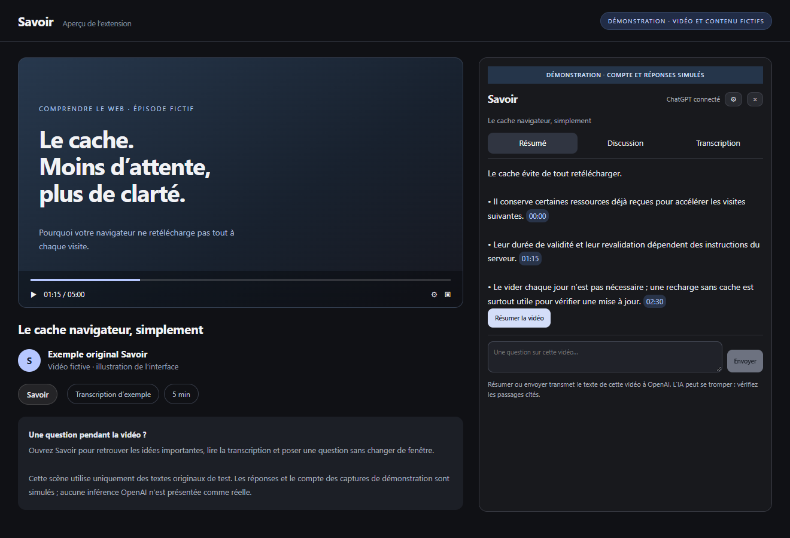

<div align="center">
  
  <h1>Savoir</h1>
  <p><strong>Comprendre une vidéo, sans la quitter.</strong></p>
  <p>Résumé, questions et transcription à côté de YouTube.<br>Sans modèle à installer. Sans programme à lancer à chaque fois.</p>
  <p>
    <a href="https://github.com/A-Arnaud/Savoir/actions/workflows/ci.yml"></a>
    <a href="LICENSE"></a>
    
  </p>
  <p><a href="https://github.com/A-Arnaud/Savoir/releases/tag/v0.2.0-beta.1"><strong>Télécharger la bêta Windows</strong></a> · <a href="docs/installation.md">Installation illustrée</a> · <a href="docs/faq.md">Questions fréquentes</a></p>
</div>

> [!IMPORTANT]
> Savoir est en bêta. L’installateur n’est pas signé et l’extension n’est pas encore sur le Chrome Web Store. La connexion et la génération réelles avec votre compte ChatGPT restent à valider ; l’accès dépend des autorisations et quotas de votre compte. Aucun accès API payant de secours n’est activé.

<a href="docs/assets/overview.png"></a>

*Interface réelle. Vidéo, transcription, compte et réponses de cette scène sont des exemples de démonstration, pas une preuve d’inférence OpenAI. Cliquez sur l’image pour l’agrandir.*

## Une vidéo, trois façons de comprendre

| Résumé | Discussion | Transcription |
| --- | --- | --- |
| Retrouvez les points importants et les passages à vérifier. | Posez une question, demandez une explication ou retrouvez un détail. | Lisez le texte original ; collez le vôtre si les sous-titres sont indisponibles. |
| [Voir la capture](docs/assets/summary.png) | [Voir la capture](docs/assets/discussion.png) | [Voir la capture](docs/assets/transcript.png) |

- **Dans la même fenêtre.** Le panneau se place à côté de la vidéo.
- **À la demande.** Pas d’analyse automatique quand vous regardez simplement YouTube.
- **Sans modèle local.** Le connecteur est inclus dans l’installateur ; Python n’est pas nécessaire pour utiliser l’application.
- **Des sources à vérifier.** Les repères cliquables correspondent à des temps présents dans la transcription. Aucun repère fictif pour un texte sans horaires.
- **Pas de serveur à démarrer.** Le navigateur lance le connecteur à l’ouverture du panneau et l’arrête à sa fermeture.

## Commencer en trois étapes

### 1. Installer Savoir

Téléchargez puis ouvrez [Savoir-Setup-0.2.0.exe](https://github.com/A-Arnaud/Savoir/releases/download/v0.2.0-beta.1/Savoir-Setup-0.2.0.exe). Le guide s’ouvre à la fin de l’installation. Windows peut signaler que l’exécutable n’est pas signé : vérifiez la provenance et le [SHA256 fourni avec la release](https://github.com/A-Arnaud/Savoir/releases/tag/v0.2.0-beta.1) avant de décider de l’exécuter.

### 2. Activer l’extension

Dans `chrome://extensions` ou `edge://extensions`, activez le mode développeur puis **Charger l’extension non empaquetée**. Sélectionnez :

```text
%LOCALAPPDATA%\Programs\Savoir YouTube\extension
```

Désactivez une ancienne version de cette même extension si nécessaire. Cette activation manuelle n’est requise qu’au départ ; un dépôt GitHub ne remplace pas le Chrome Web Store.

### 3. Ouvrir une vidéo

Sur YouTube, cliquez sur **Savoir**, puis **Continuer avec ChatGPT**. La connexion passe par la page officielle OpenAI. Ne communiquez jamais votre mot de passe à Savoir, dans une issue ou à un assistant.

[Le guide illustré détaille chaque étape →](docs/installation.md)

## Vos données, simplement

La transcription est récupérée à votre demande. **Résumer** ou **Envoyer** transmet le texte nécessaire à OpenAI. Les jetons de connexion restent dans le connecteur, protégés par Windows DPAPI, jamais dans la page YouTube. Aucun cookie ChatGPT n’est récupéré.

Les caches et conversations terminées sont locaux. Une transcription importée dans un onglet ne remplace pas silencieusement la source d’un autre. Les réponses interrompues ne sont pas réutilisées comme si elles étaient terminées.

[Lire la politique de confidentialité →](docs/privacy.md)

## Ce qui est vérifié — et ce qui ne l’est pas

Tests automatiques du protocole, de l’authentification avec transports de test, de DPAPI sous Windows, des sources, de l’interface et du build. Des tests navigateur distinguent le vrai connecteur installé d’un compte/transport explicitement synthétique. La récupération publique de sous-titres a également été exercée sans inférence.

La connexion OpenAI et la qualité/vitesse d’une génération avec un compte réel ne sont **pas encore validées**. Les sous-titres peuvent manquer ou être bloqués par YouTube. L’IA peut se tromper ; vérifiez les passages cités. Aucun chiffre de vitesse universel ni promesse de « zéro ressource ».

Le connecteur actuel cible Windows x64. Les essais locaux ont été réalisés sous Windows 10 ; ils ne constituent pas une certification sur un poste Windows 11 physique. macOS/Linux et la publication Web Store ne sont pas inclus dans cette bêta.

## Contribuer

[Développer et lancer les tests](docs/development.md) · [Signaler un problème](https://github.com/A-Arnaud/Savoir/issues/new/choose) · [Contribuer](CONTRIBUTING.md) · [Sécurité](SECURITY.md) · [Changements](CHANGELOG.md)

Code original sous [licence MIT](LICENSE). Les dépendances conservent [leurs propres licences](THIRD_PARTY_NOTICES.md). Projet indépendant, non affilié à OpenAI, YouTube ou Google.
