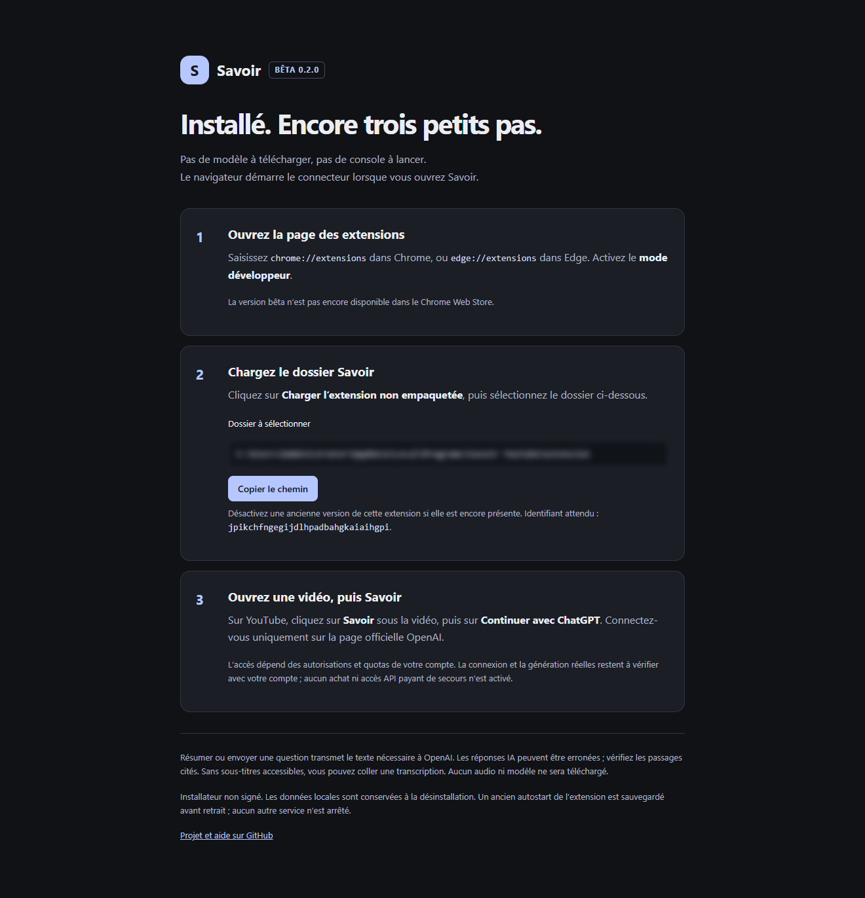
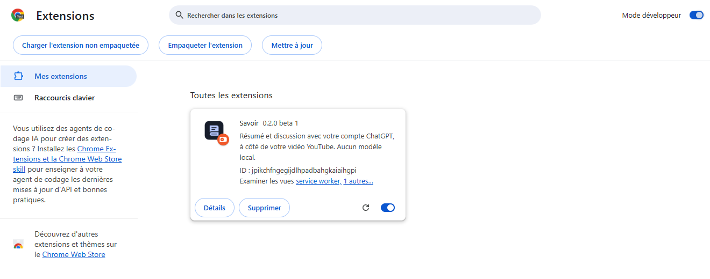
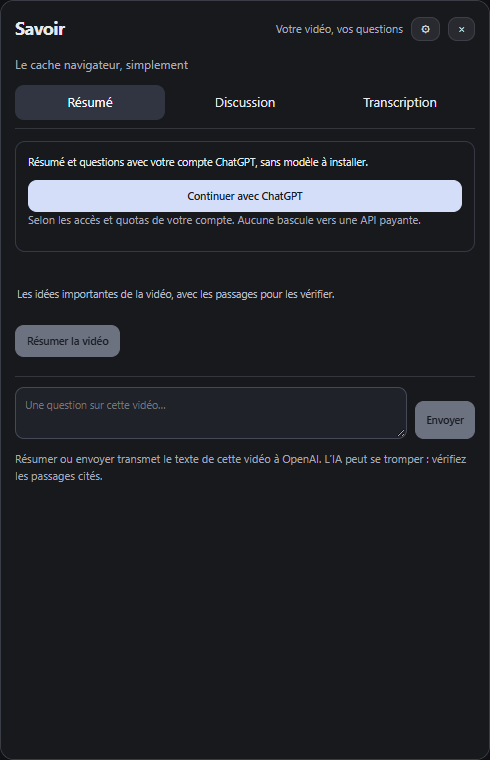

# Installer Savoir

[← Accueil](../README.md)

Vous avez besoin d’un PC Windows 64 bits, de Chrome ou Edge et d’une connexion Internet. Aucun modèle IA, Python ou Node.js n’est nécessaire pour utiliser la version installée. L’accès ChatGPT dépend de votre compte ; cette bêta ne garantit pas son éligibilité.

## 1. Télécharger et installer

1. Ouvrez la [release bêta officielle](https://github.com/A-Arnaud/Savoir/releases/tag/v0.2.0-beta.1).
2. Téléchargez `Savoir-Setup-0.2.0.exe`. `SHA256SUMS.txt` permet d’en vérifier l’intégrité.
3. Lancez-le, puis suivez l’assistant. L’installation est propre à votre utilisateur, sans service au démarrage de Windows.

L’installateur n’est pas signé : un avertissement Windows est possible. Ne désactivez pas votre antivirus et ne contournez pas une alerte dont vous ne comprenez pas la cause. Vérifiez le dépôt d’origine et le hash ; en cas de doute, attendez ou compilez les sources.

Le guide **Premiers pas** s’ouvre à la fin. Vous pouvez le retrouver dans le menu Démarrer, dossier **Savoir YouTube**.



*Guide de la version installée. Le chemin personnel est masqué sur la capture.*

## 2. Activer dans Chrome ou Edge

1. Saisissez `chrome://extensions` dans la barre d’adresse de Chrome, ou `edge://extensions` dans Edge.
2. Activez **Mode développeur**.
3. Cliquez sur **Charger l’extension non empaquetée** (*Load unpacked* en anglais).
4. Sélectionnez le dossier `extension` indiqué par le guide. Par défaut :

```text
%LOCALAPPDATA%\Programs\Savoir YouTube\extension
```

Le bouton **Copier le chemin** du guide fournit le chemin complet de votre PC. Ne sélectionnez pas le dossier parent ni l’installateur `.exe`.



Une ancienne version de l’extension peut encore s’appeler Cypher. Désactivez-la avant d’activer Savoir pour éviter deux versions. Ne supprimez pas un autre produit au nom similaire.

Identifiant attendu : `jpikchfngegijdlhpadbahgkaiaihgpi`. L’ID et l’hôte natif historiques restent stables pour la compatibilité. Rien n’est installé silencieusement dans votre profil navigateur : Chrome impose cette activation tant qu’il n’y a pas de publication Web Store.

## 3. Connecter et utiliser

1. Ouvrez une vidéo sur `youtube.com`.
2. Cliquez sur **Savoir**, sous la vidéo.
3. Cliquez sur **Continuer avec ChatGPT**. Identifiez-vous uniquement dans la page officielle OpenAI et examinez les autorisations demandées.
4. Si votre compte est éligible et autorisé, utilisez **Résumer la vidéo**, posez une question ou ouvrez **Transcription**.



Aucun compte réel n’a été utilisé pour valider cette bêta. En cas de refus d’accès ou de quota, Savoir doit afficher l’erreur ; il ne bascule pas sur une API payante.

## Au quotidien

Vous n’avez plus de console, de `.bat` ou de modèle à démarrer. Le connecteur se lance à l’ouverture du panneau, puis se ferme après son dernier panneau. Fermer le panneau annule les opérations locales ; cela ne garantit pas l’arrêt interne immédiat d’un serveur distant.

Sans sous-titres accessibles : ouvrez **Transcription → Coller une transcription si nécessaire**, collez le texte et cliquez sur **Utiliser ce texte**. Un texte sans temps n’obtient pas de faux horaires.

## Mise à jour et désinstallation

Fermez les panneaux Savoir avant une mise à jour. Installez la nouvelle version, puis cliquez sur **Actualiser** dans la page des extensions si nécessaire. Si Chrome utilise encore l’ancien dossier, rechargez celui de l’installation actuelle.

Pour désinstaller : **Paramètres Windows → Applications → Savoir**, puis retirez l’extension dans le navigateur. Les données utilisateur sont conservées ; voyez [Confidentialité](privacy.md) pour les supprimer volontairement après déconnexion.

[Un problème ? Consultez la FAQ →](faq.md)
